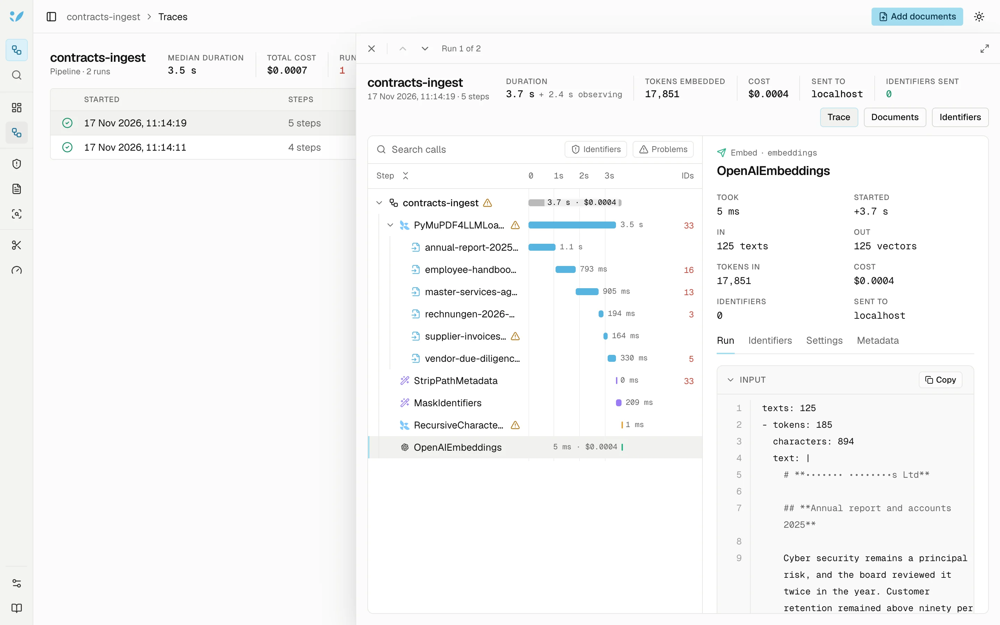

<div align="center">
  <picture>
    <source media="(prefers-color-scheme: dark)" srcset="https://raw.githubusercontent.com/complydoc/complydoc/main/.github/images/logo-dark.svg">
    
  </picture>

  <h3>Get document loading right.</h3>
  <p>Compare loaders, trace every step and evaluate what reaches your model.</p>

  <a href="https://pypi.org/project/complydoc/"></a>
  <a href="https://github.com/complydoc/complydoc/actions/workflows/checks.yml"></a>
  <a href="https://complydoc.io/docs/"></a>
  <a href="https://opensource.org/licenses/MIT"></a>
</div>

<!-- mcp-name: io.github.complydoc/complydoc -->

<br>

<picture>
  <source media="(prefers-color-scheme: dark)" srcset="https://raw.githubusercontent.com/complydoc/complydoc/main/.github/images/viewer-trace-dark.webp">
  
</picture>

A PDF can say one thing to a person and another to your model. White text, tiny type, an
IBAN behind a black bar: it's all still in the text layer, and most loaders pass it straight
through. complydoc shows what your loaders actually extracted, flags hidden text and
personal and financial identifiers before they're embedded, and traces every ingestion step
with its time and cost. Nothing leaves your machine.

Works with LangChain, LlamaIndex, Unstructured, Haystack, Docling, LlamaParse, Azure
Document Intelligence, Marker, Chonkie and the common vector stores and embedding APIs.

## Try it

```bash
uv tool install complydoc
complydoc ui ./documents
```

`complydoc ui` audits the folder and opens the viewer on it, served from your machine. To
see a hidden clause caught, try the one-page contract in
[`examples/hidden_clause.pdf`](examples/hidden_clause.pdf).

## In your assistant

`complydoc mcp` lets any MCP client, such as Claude, Cursor, VS Code (Copilot),
Windsurf or Codex, open documents with personal and financial details masked and hidden
instructions taken out. It runs on your machine:

```bash
uvx complydoc mcp --folder ~/Documents/Contracts
```

[](https://insiders.vscode.dev/redirect/mcp/install?name=complydoc&config=%7B%22name%22%3A%22complydoc%22%2C%22command%22%3A%22uvx%22%2C%22args%22%3A%5B%22complydoc%22%2C%22mcp%22%5D%7D)
[](https://cursor.com/en/install-mcp?name=complydoc&config=eyJjb21tYW5kIjoidXZ4IiwiYXJncyI6WyJjb21wbHlkb2MiLCJtY3AiXX0=)

It is in the [MCP Registry](https://registry.modelcontextprotocol.io) as
`io.github.complydoc/complydoc`, as a Claude Desktop extension on the
[releases page](https://github.com/complydoc/complydoc/releases/latest), as a Claude Code
plugin (`/plugin install complydoc --marketplace complydoc/complydoc`) and as the image
`ghcr.io/complydoc/complydoc`. The setup for each client is in
[Documents into an assistant, cleaned](https://complydoc.io/docs/guides/assistant-mcp/).

## Observe a pipeline

```python
import complydoc as cd

with cd.observe("contracts-ingest"):
    documents = PyMuPDF4LLMLoader("contract.pdf").load()
    chunks = splitter.split_documents(documents)
    vector_store.add_documents(chunks)
```

Every loader, splitter, embedding call and vector store becomes a step, with its settings,
time, tokens, cost and the identifiers it passed on. Open it with `complydoc ui`.

## What it shows

- **Traces** of each ingestion step, and how runs compare over time.
- **Loader diffs**: each loader's reading of a page side by side, with the page itself.
- **Identifiers** from Europe, the Americas, India and Australia, checksum-validated and
  masked until you choose to see them.
- **Hidden content**: text a reader does not see and a model does, and instructions
  written to a model.
- **Evals**: the facts a document must keep, checked on every reading.
- **Chunks and cost**: splitters side by side, and tokens priced across models.

## In CI

```yaml
- uses: complydoc/complydoc@v0.8.2
  with:
    path: documents
    policy: policy.yaml
```

`complydoc check` fails when a folder breaks your rules; `finance`, `legal` and `hr` ship as
ready policies. See [GitHub Action](https://complydoc.io/docs/guides/github-action/).

## Privacy

complydoc runs on your machine and sends nothing anywhere: every run blocks outbound
connections. `complydoc mcp` reads only the folders you share, keeps the list of folders
chosen in a conversation in `~/.complydoc/mcp-folders.json` and writes clean copies only
where you ask. The one download is the optional name model, fetched once from Hugging Face
when you ask for it. Questions go to the
[issue tracker](https://github.com/complydoc/complydoc/issues).

## More

- [Documentation](https://complydoc.io/docs/), and the
  [playground](https://github.com/complydoc/playground) with everything ready to run
- [Run it for your team](https://complydoc.io/docs/guides/team/), in a
  [container](https://complydoc.io/docs/guides/container/) or from a bucket
- [Network isolation](https://complydoc.io/docs/explanation/offline/): every
  run blocks outbound connections and records that it did
- Optional extras for scans and names: `complydoc doctor` says what is installed and how to
  add the rest
- [Changelog](https://github.com/complydoc/complydoc/blob/main/src/complydoc/CHANGELOG.md) ·
  [Contributing](https://github.com/complydoc/complydoc/blob/main/CONTRIBUTING.md) ·
  [Security](https://github.com/complydoc/complydoc/blob/main/SECURITY.md) · MIT

If complydoc is useful to you, a star helps other engineers find it.
